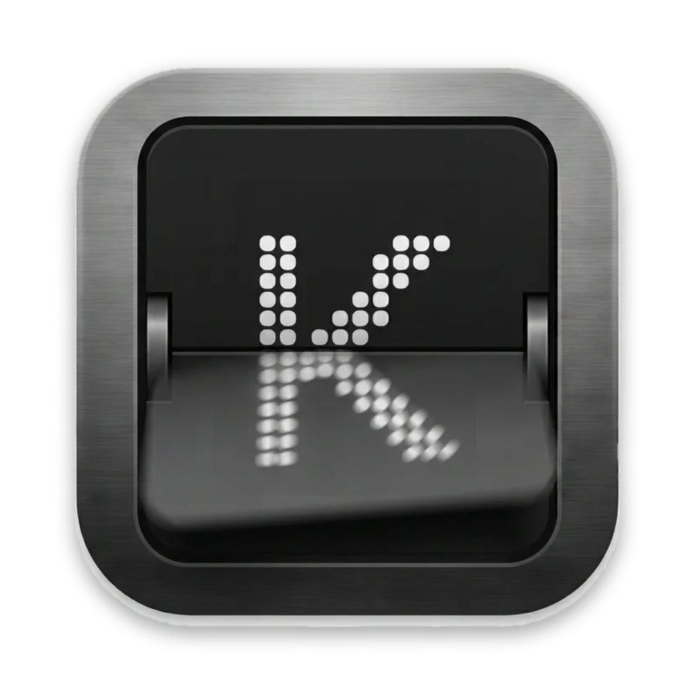

<p align="center">
  
</p>

<h1 align="center">Kappa</h1>

<p align="center">
  Un ticker flotante sobre la barra de menús de macOS: tu agenda, plazos, cambio, papers, noticias y mails, siempre a la vista.
</p>

---

Kappa es una app nativa para macOS (Swift + SwiftUI) que no ocupa lugar en el Dock ni en la barra de menús: dibuja una franja fina encima de la barra, en una sola línea, con lo que querés tener presente durante el día. Pasás el mouse y se pausa; hacés clic y te muestra el detalle.

## Qué muestra

| | Fuente | Detalle |
|---|---|---|
| 📅 | **Agenda** | Eventos de tus calendarios. Los de hoy dicen cuánto falta (`en 2 h 15 m`); los demás, día y hora (`Lu 15.45`). Si el evento tiene un link, el segundo clic lo abre. |
| ⏳ | **Plazos** | Cuenta regresiva a las fechas que cargues (entregas, postulaciones, etc.). |
| 💵 | **Cambio** | Cotizaciones del dólar. |
| 📚 | **Papers** | Los dos últimos papers abiertos en [Jevons](#integración-con-jevons), cada uno como `Leer: Título`. |
| 📰 | **Noticias** | Titulares de los feeds RSS que agregues, con el ícono del diario en el globo de detalle. |
| ✉️ | **Mail** | Aviso único `🟢 Remitente` cuando llega un mail y un resumen periódico de los no leídos de hoy. Elegís de qué cuentas. |

Nada ocupa más de una línea: si no entra, se corta con "…" (en eventos y plazos siempre se conserva la hora o el tiempo restante y se recorta primero el título).

## Cómo se usa

- **Pausar:** poné el mouse encima.
- **Mover:** rueda del mouse (con o sin Shift) o scroll horizontal del trackpad.
- **Detalle:** primer clic abre un globo; el segundo abre el link o la app del ítem.
- **Menú:** clic derecho → actualizar, ajustes, salir.
- **Dónde aparece:** con monitor externo, centrado en ese monitor; sin monitor, a la derecha del notch.

### Estilos y fondos

- **Scroll continuo** o **Cartelera** (estilo tablero de aeropuerto, con páginas que giran).
- Fondos: Cristal oscuro, Cristal claro, Negro y Blanco.

## Instalación

Necesitás macOS 14 o superior y las herramientas de línea de comandos de Xcode.

```bash
xcode-select --install        # una sola vez, si no las tenés
git clone https://github.com/sanarovaz/Kappa.git
cd Kappa
bash construir.command
```

El script compila, arma `Kappa.app` en la misma carpeta, la firma localmente y la abre. Para tenerla siempre, arrastrala a `/Aplicaciones` y activá "Abrir al iniciar sesión" en Ajustes.

> Como la app está firmada solo de forma local, si la movés o la descargás ya compilada, macOS puede pedirte confirmar la apertura (clic derecho → Abrir).

### Permisos

- **Calendarios:** la primera vez que leés la agenda.
- **Automatización (Mail):** solo si activás los avisos de mail. Kappa lee tus mails a través de Mail.app y, si está cerrada, la abre oculta en segundo plano.

Todo se procesa en tu Mac. Kappa no tiene servidor propio ni envía tus datos a ningún lado; solo consulta las fuentes que activás (cotizaciones y feeds de noticias).

## Ajustes

Ventana con una barra lateral:

- **General:** ubicación, anchos, frecuencia de actualización, abrir al iniciar sesión.
- **Apariencia:** estilo, velocidad, fondo.
- **Contenido:** Agenda, Plazos, Cambio, Papers, Noticias, Mail.
- **Avanzado:** fluidez de la animación, conexión directa con Google (opcional), registro y restablecer.

## Integración con Jevons

Kappa lee un archivo JSON (por defecto `~/Jevons/ultimo-paper.json`) con los dos últimos papers abiertos, el más reciente primero. Podés elegir otra ruta en Ajustes → Papers.

```json
[
  { "title": "Título del paper", "authors": "Autor, Autor", "url": "jevons://..." },
  { "title": "Otro paper",       "authors": "Autor",         "url": "jevons://..." }
]
```

## Limitaciones conocidas

- Ocultar los íconos de otras apps de la barra de menús es experimental y depende de la versión de macOS y del monitor.
- La protección contra solapar los íconos del lado derecho no funciona en macOS 27.
- Evitar los menús de la app activa requiere el permiso de Accesibilidad.

## Estructura del código

```
Package.swift            Paquete Swift (ejecutable "Kappa")
Info.plist               Metadatos de la app
construir.command        Compila y arma Kappa.app
Resources/               Ícono
Sources/BarraTicker/
  Config.swift           Ajustes y persistencia
  Sources.swift          Agenda, plazos, cambio, papers, noticias
  MailMonitor.swift      Mail vía Mail.app
  GmailAPI.swift         Conexión directa opcional con Gmail
  Store.swift            Refresco, avisos de mail y mezcla de fuentes
  TickerView.swift       Scroll continuo
  SplitFlap.swift        Cartelera
  PanelController.swift  Panel sobre la barra, mouse y globo de detalle
  DetailPopup.swift      Globo de detalle y favicons
  StatusController.swift Menú y modo ítem de barra
  SettingsView.swift     Ventana de Ajustes
```

El nombre de la carpeta `Sources/BarraTicker` es el de la primera versión del proyecto.
